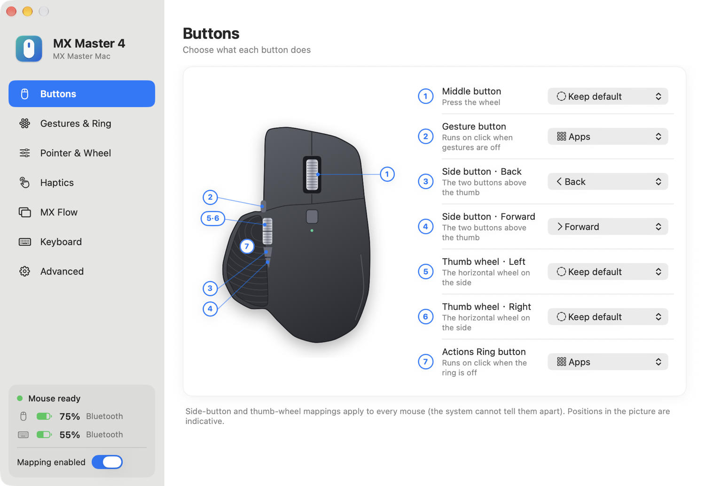
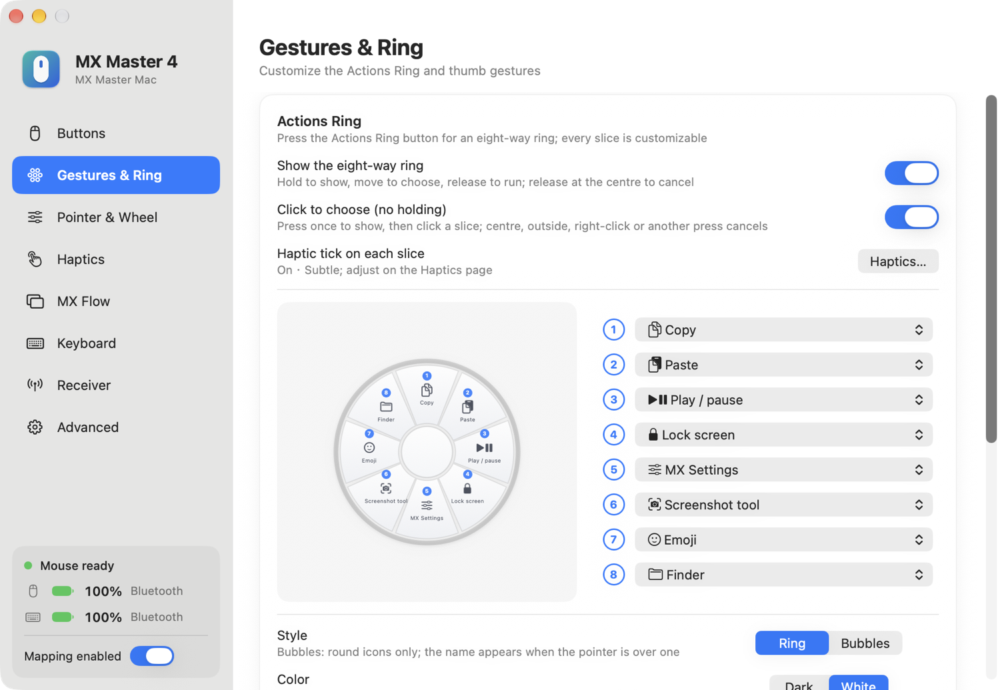
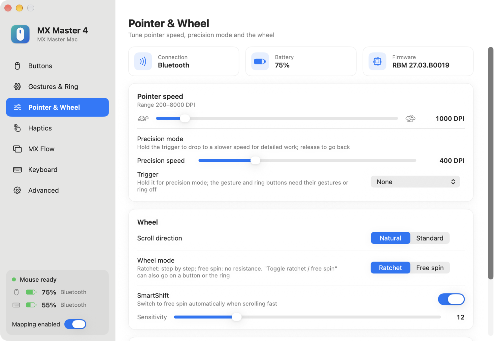
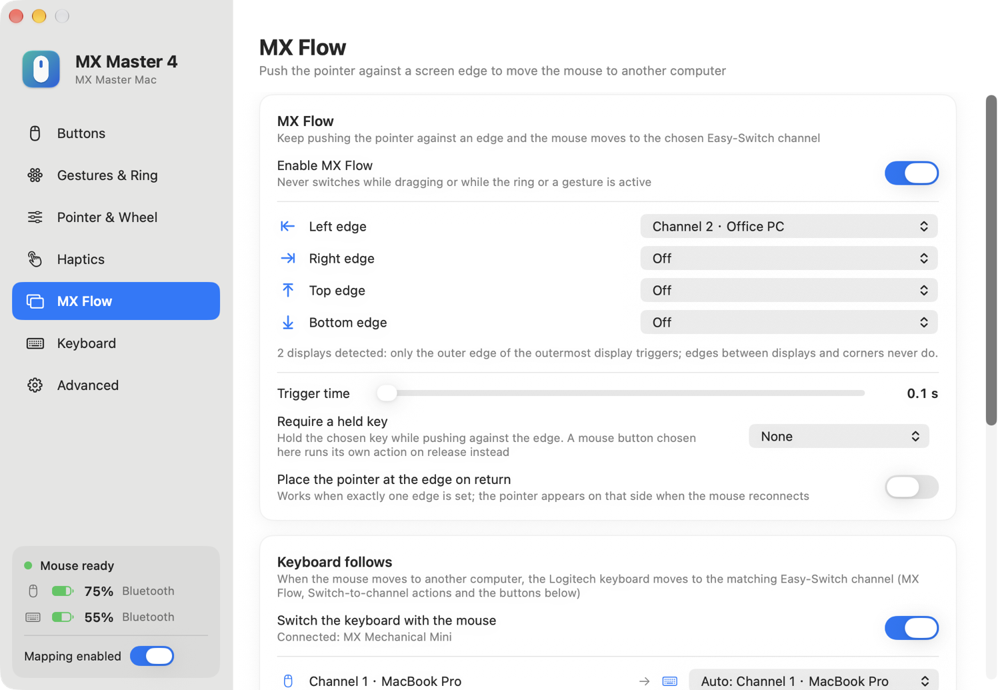
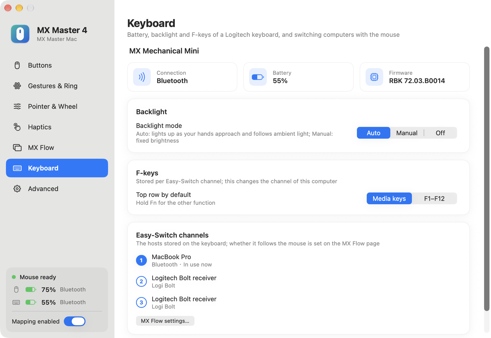
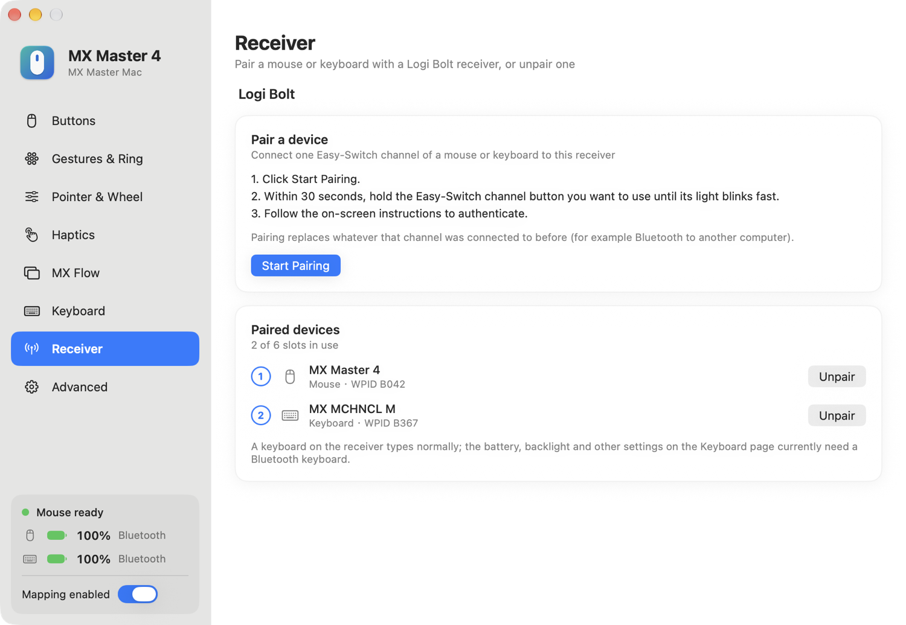
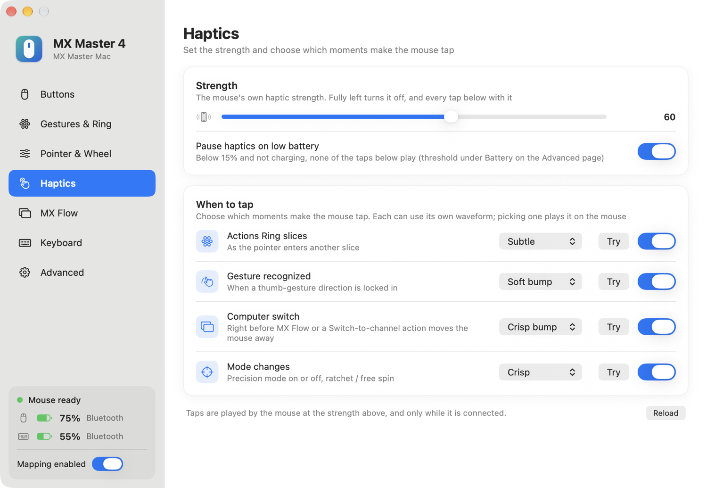
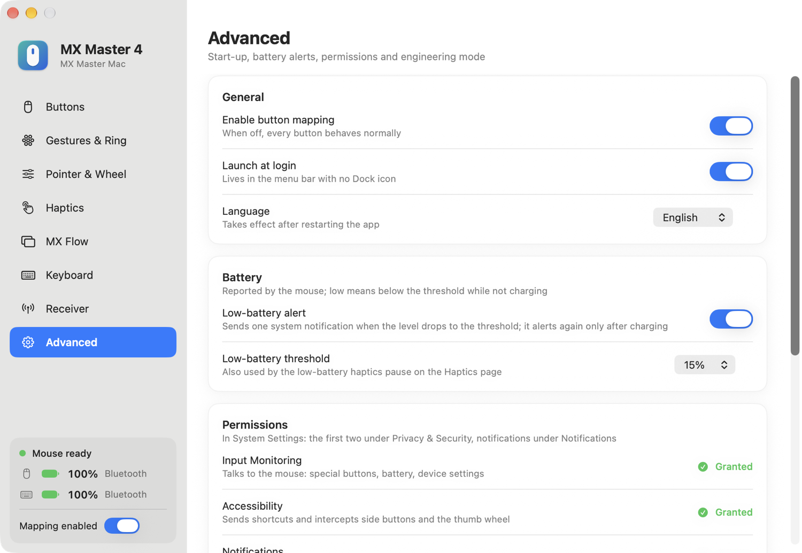

# MX Master Mac

<p align="center">
  <a href="README.md">繁體中文</a> · <strong>English</strong>
</p>

<p align="center">
  
</p>

MX Master Mac is a lightweight macOS utility for the Logitech MX Master 4. It lives in the menu bar and lets you customize buttons, thumb gestures and the Actions Ring, and adjust pointer speed, SmartShift, scroll direction and haptic feedback, without Logi Options+. Version 2.0 adds **MX Flow**: push the pointer against a screen edge and the mouse moves to another computer. Since 2.3 it also supports a Logitech keyboard: battery, backlight and F-keys, and the keyboard can follow the mouse to the other computer. Since 2.4 you can pair devices with a Logi Bolt receiver right in the app. It is the macOS edition of the same product as [MX Master Win](https://github.com/stone5202/MXMasterWin) for Windows (formerly MX Master Portable), with the same features and the same way of setting them up, rewritten in Swift. Run one edition on each computer and MX Flow takes the mouse back and forth between Mac and Windows.

> Current version: 2.4 · Interface languages: Traditional Chinese, English (follows the system by default)

See the [changelog](CHANGELOG.en.md) or [GitHub Releases](https://github.com/stone5202/MXMasterMac/releases) for what changed in each version.

> This is an independent open-source project. It is not affiliated with, endorsed by or sponsored by Logitech. Logitech, MX Master, Logi Options+ and Logi Bolt are trademarks of Logitech.

## Screenshots

<p align="center">
  
</p>

<p align="center">
  
  &nbsp;
  
</p>

<p align="center">
  Buttons · Gestures & Ring · Pointer & Wheel
</p>

<p align="center">
  
  &nbsp;
  
</p>

<p align="center">
  MX Flow · Keyboard
</p>

<p align="center">
  
  &nbsp;
  
</p>

<p align="center">
  Receiver · Haptics
</p>

<p align="center">
  
</p>

<p align="center">
  Advanced (battery)
</p>

## Download and use

1. Download `MXMasterMac.zip` from [Releases](https://github.com/stone5202/MXMasterMac/releases/latest), unzip it and drag `MX Master Mac.app` to Applications.
2. The app is not notarized by Apple. macOS blocks the first launch: go to System Settings → Privacy & Security and click Open Anyway at the bottom.
3. Grant the two permissions when prompted (see Permissions below).
4. It then stays in the menu bar (mouse icon); click it to open settings, pause or quit.

Quit Logi Options+ first: running both makes them overwrite each other's button and device settings.

## Features

- **Button mapping**: middle button, gesture button, both side buttons, thumb wheel left and right, and the Actions Ring button each get their own action.
- **Built-in actions**: about 55, including back / forward, Mission Control, App Exposé, Show Desktop, switch desktop, switch app, copy / paste / cut, undo / redo, select all / save / find, play / pause, previous / next track, volume and mute, tabs (new / close / reopen / refresh / zoom), windows (minimize / close / full screen), Spotlight, screenshot, emoji, lock screen, Finder, System Settings, Calculator, Activity Monitor, type today's date or the current time, Enter, Esc, Delete, "MX Settings", which opens this app's settings window, plus precision mode (hold / toggle), toggle ratchet / free spin, and switch to channel 1 / 2 / 3 (Easy-Switch).
- **Custom actions**: record any key combination, or open an app, file, folder or URL.
- **Actions Ring**: all eight positions are customizable. Choose hold mode (hold to show, move to choose, release to run) or click mode (press once to show, then click). Two looks, Ring and Bubbles, in dark or white, with adjustable size and opacity. The mouse taps lightly as the pointer moves onto another slice (turn it off or change the waveform on the Haptics page).
- **Four-way thumb gestures**: hold the gesture button and swipe; all four directions and the sensitivity are customizable.
- **Haptics**: set the mouse's haptic strength and four haptic moments separately: ring slices, gesture recognized, before a computer switch, and mode changes. Each can be switched on or off, given one of six waveforms and tried.
- **Precision mode**: hold the chosen button to drop the pointer to a slower DPI (400 by default) for detailed work such as photo editing or alignment; release to go back. It can also be toggled from the ring or a gesture. When precision mode or ratchet / free spin changes, the new state shows briefly at the bottom of the screen.
- **Battery** (Advanced page): one system notification when the level drops to the threshold (15% by default) while not charging, and haptics can pause automatically to save power.
- **Device settings**: shows battery level and firmware version; adjusts pointer speed (DPI), SmartShift, ratchet torque, scroll direction, high-resolution wheel, thumb-wheel direction and haptic strength. Applied values are saved and re-applied when the mouse reconnects.
- **MX Flow**: keep pushing the pointer against a screen edge and the mouse moves to the Easy-Switch channel you chose (another computer). Each of the four edges can target its own channel, the trigger time is adjustable, and a held keyboard key or mouse button can be required; with several displays only the outer edge of the outermost display triggers. The page also lists the computer stored on each of the three channels, with a button to switch directly; the menu bar menu has an MX Flow switch as well.
- **Keyboard** (since 2.3): for a Logitech keyboard connected to this Mac over Bluetooth (tested with an MX Mechanical Mini), the Keyboard page shows connection, battery and firmware and sets the backlight (automatic, manual brightness or off) and whether the top row sends media keys or F1–F12; since 2.4 it can also disable the keys the keyboard allows (Caps Lock, for one), set the OS layout for the current channel, and set backlight delays for hands away, hands near and external power; the bottom-left corner shows both mouse and keyboard battery.
- **Keyboard follows the mouse** (since 2.3): when the mouse moves to another computer (MX Flow, a Switch-to-channel action or the Switch button), the keyboard moves to the matching Easy-Switch channel. Each mouse channel can pick a keyboard channel; Automatic uses the channel with the same computer name, otherwise the same number.
- **Logi Bolt receiver** (since 2.4): on the Receiver page, pair a new mouse or keyboard (passkey typed on the keyboard or clicked on the mouse), list paired devices and unpair them, without Logi Bolt or Options+.
- **Channel names** (since 2.4): when the current channel of the mouse or keyboard stores a different name from this computer ("Logitech Bolt receiver", for one), this computer's name is written, so MX Flow and the keyboard's automatic matching are more accurate.
- **Recovers after a connection change**: when the mouse goes to another computer and comes back, or switches between Bluetooth and Logi Bolt, the special buttons are re-enabled automatically.
- **Other**: settings save automatically, single instance, can be paused, optional launch at login, Chinese / English interface.
- **Engineering mode**: view the events the mouse sends, for reporting problems.

## Requirements

- macOS 14 or later on Apple silicon (developed and tested on macOS 27)
- Logitech MX Master 4 (Bluetooth or the Logi Bolt receiver)
- Keyboard features (optional): a Logitech HID++ 2.0 keyboard connected over Bluetooth
- Receiver page (optional): a Logi Bolt receiver (Unifying is not supported)

## Permissions

- **Input Monitoring**: talks to the mouse through the built-in macOS HID interface (special buttons, battery, device settings).
- **Accessibility**: sends shortcuts and intercepts the side buttons and thumb wheel.
- **Notifications** (optional): low-battery alerts. Can be allowed in advance on the Advanced page; without it a hint shows at the bottom of the screen instead.

## Known limitations

- Developed and tested only on the MX Master 4 (firmware `RBM 27.03`); other models are untested.
- The release build is neither notarized nor signed with a developer certificate; after updating you may need to grant the two permissions again.
- When running alongside Logi Options+, the two overwrite each other's diversion and device settings. Use only one.
- Side-button and thumb-wheel mappings apply to every mouse (system events do not identify the source device).
- Mission Control, App Exposé, Show Desktop and desktop switching send the default system shortcuts; they do nothing if those shortcuts were changed or disabled in System Settings → Keyboard → Keyboard Shortcuts.
- MX Flow transfers no clipboard or files. To come back the same way, the other computer must also run a version with MX Flow and have an edge set; for the keyboard to come back too, that version must also have "keyboard follows"; otherwise press the Easy‑Switch buttons on the mouse and keyboard.
- Keyboard features are tested only with an MX Mechanical Mini and support only keyboards connected over Bluetooth (the Keyboard page does not support a keyboard on a Logi Bolt receiver yet, though the Receiver page can pair or unpair it). Channels paired through Bolt are often stored as "Logitech Bolt receiver" on the keyboard, so Automatic uses the same channel number; choose them by hand on the MX Flow page if needed.
- When the mouse reconnects, the app cannot tell which computer it came from; with more than one edge set, the pointer is not moved to an edge.
- Per-application profiles and firmware updates from Options+ are not included.
- Button positions in the diagram are indicative and have not been checked against the hardware one by one.

## How it works

- Special buttons (gesture button `0x00C3`, Actions Ring button `0x01A0`): through `IOHIDManager`, HID++ 2.0 feature `0x1B04` sets temporary diversion and the app receives the button notifications. Diversion is released when the app is paused or quits.
- Standard buttons and the horizontal wheel: intercepted with a `CGEventTap`; keyboard actions are posted with `CGEvent`.
- Device settings: HID++ features `0x1004` (battery), `0x0003` (firmware), `0x2201` (DPI), `0x2111` (SmartShift and ratchet torque), `0x2121` (scroll direction and high resolution), `0x2150` (thumb-wheel direction), `0x19B0` (haptic strength and waveform playback). Every write is read back. Precision mode temporarily writes a lower DPI and restores the original speed on release, pause, quit, or before switching to another computer.
- MX Flow: `NSEvent` monitors watch pointer movement to tell when the pointer is held against the outer edge of the outermost display; the switch is sent with HID++ feature `0x1814` (Change Host), and `0x1815` reads the host name stored on each channel and writes this computer's name to the current channel when it differs.
- Keyboard: a second `IOHIDManager` reads only HID++ reports (never typing), uses `0x0005` to tell a keyboard from a mouse, and `0x1004` (battery), `0x0003` (firmware), `0x1982` (backlight and delays), `0x40A3` (F-keys), `0x4521` (disabled keys) and `0x4531` (OS layout); channel switching also uses `0x1814`.
- Receiver: another `IOHIDManager` talks only to the Logi Bolt receiver itself and uses its registers to discover, pair and unpair (`0xC0`, `0x2C1`, `0x2B5`); wireless notifications are turned on during pairing and restored afterwards.
- Reconnect detection: `0x1D4B` notifications, device arrival / removal, and system wake; while disconnected it retries every 3 seconds.

HID++ feature ids and packet layouts follow the public implementations in [Solaar](https://github.com/pwr-Solaar/Solaar) and [logiops](https://github.com/PixlOne/logiops).

## Privacy

- The app makes no network connections and contains no analytics, ads or tracking.
- Settings are stored in `~/Library/Application Support/MXMasterMac/config.json`.
- Mouse events are written to `events.log` in the same folder only while "Write to log file" is on in engineering mode; the log holds button and HID packets, not keyboard input.
- No driver or system extension is installed.

## Build from source

Requires Xcode (only its `swiftc`); there are no external dependencies:

```bash
git clone https://github.com/stone5202/MXMasterMac.git
cd MXMasterMac
./build.sh
open "build/MX Master Mac.app"
```

`build.sh` signs with an Apple Development certificate from the keychain (so permissions survive rebuilds) and falls back to ad hoc signing. `./build.sh --release` produces the ad hoc signed release archive `build/MXMasterMac.zip`.

Launch arguments: `--show` opens the settings window, `--log` starts writing the engineering log.

## Contributing

Issues and pull requests are welcome. When reporting a button or device problem, include the engineering-mode log, the connection type, the macOS version and the mouse firmware version.

## License

Released under the [MIT License](LICENSE).
