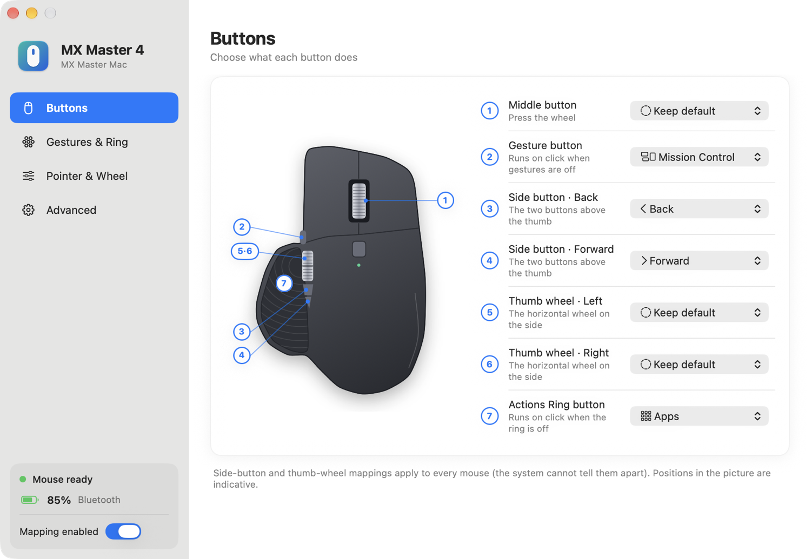
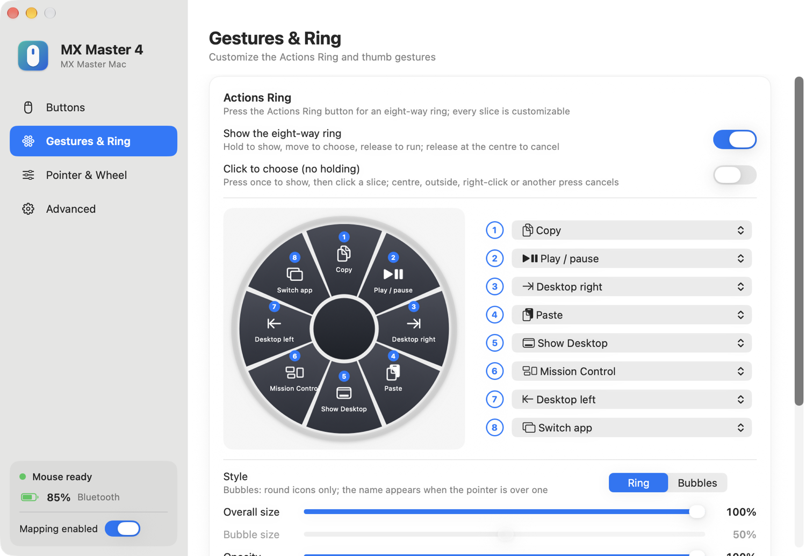
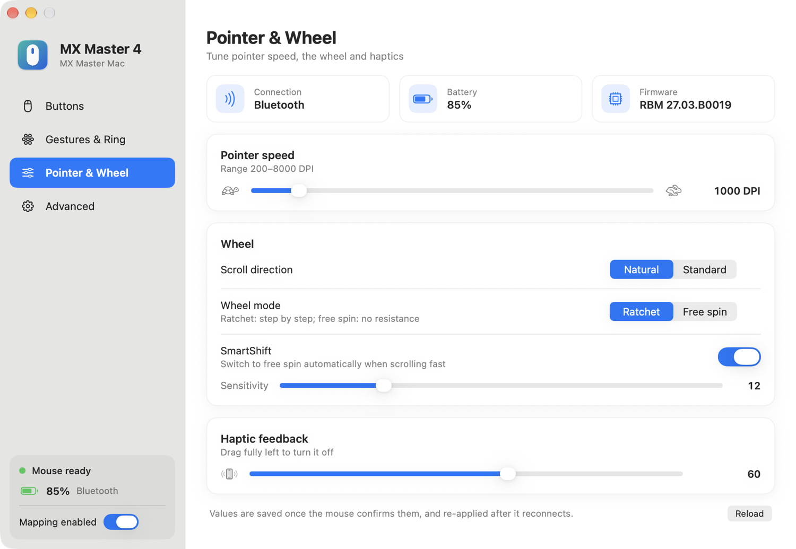
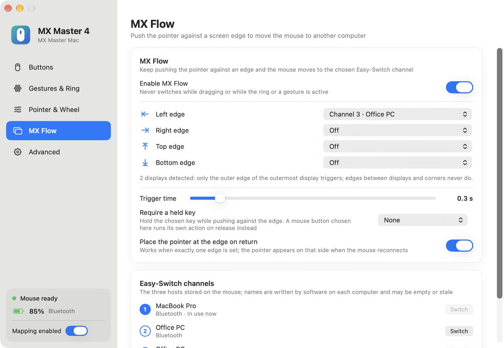

# MX Master Mac

<p align="center">
  <a href="README.md">繁體中文</a> · <strong>English</strong>
</p>

<p align="center">
  
</p>

MX Master Mac is a lightweight macOS utility for the Logitech MX Master 4. It lives in the menu bar and lets you customize buttons, thumb gestures and the Actions Ring, and adjust pointer speed, SmartShift, scroll direction and haptic feedback, without Logi Options+. Version 2.0 adds **MX Flow**: push the pointer against a screen edge and the mouse moves to another computer. It is the macOS counterpart of the Windows tool [MX Master Portable](https://github.com/stone5202/MXMasterPortable), rewritten in Swift.

> Current version: 2.0 · Interface languages: Traditional Chinese, English (follows the system by default)

See the [changelog](CHANGELOG.en.md) or [GitHub Releases](https://github.com/stone5202/MXMasterMac/releases) for what changed in each version.

> This is an independent open-source project. It is not affiliated with, endorsed by or sponsored by Logitech. Logitech, MX Master, Logi Options+ and Logi Bolt are trademarks of Logitech.

## Screenshots

<p align="center">
  
</p>

<p align="center">
  
  &nbsp;
  
</p>

<p align="center">
  Buttons · Gestures & Ring · Pointer & Wheel
</p>

<p align="center">
  
</p>

<p align="center">
  MX Flow
</p>

## Download and use

1. Download `MXMasterMac.zip` from [Releases](https://github.com/stone5202/MXMasterMac/releases/latest), unzip it and drag `MX Master Mac.app` to Applications.
2. The app is not notarized by Apple. macOS blocks the first launch: go to System Settings → Privacy & Security and click Open Anyway at the bottom.
3. Grant the two permissions when prompted (see Permissions below).
4. It then stays in the menu bar (mouse icon); click it to open settings, pause or quit.

Quit Logi Options+ first: running both makes them overwrite each other's button and device settings.

## Features

- **Button mapping**: middle button, gesture button, both side buttons, thumb wheel left and right, and the Actions Ring button each get their own action.
- **Built-in actions**: about 50, including back / forward, Mission Control, App Exposé, Show Desktop, switch desktop, switch app, copy / paste / cut, undo / redo, select all / save / find, play / pause, previous / next track, volume and mute, tabs (new / close / reopen / refresh / zoom), windows (minimize / close / full screen), Spotlight, screenshot, emoji, lock screen, Finder, System Settings, Calculator, Activity Monitor, type today's date or the current time, Enter, Esc, Delete.
- **Custom actions**: record any key combination, or open an app, file, folder or URL.
- **Actions Ring**: all eight positions are customizable. Choose hold mode (hold to show, move to choose, release to run) or click mode (press once to show, then click). Two looks, Ring and Bubbles, with adjustable size and opacity.
- **Four-way thumb gestures**: hold the gesture button and swipe; all four directions are customizable.
- **Device settings**: shows battery level and firmware version; adjusts pointer speed (DPI), SmartShift, scroll direction and haptic strength. Applied values are saved and re-applied when the mouse reconnects.
- **MX Flow**: keep pushing the pointer against a screen edge and the mouse moves to the Easy-Switch channel you chose (another computer). Each of the four edges can target its own channel, the trigger time is adjustable, and a held keyboard key or mouse button can be required; with several displays only the outer edge of the outermost display triggers. The page also lists the computer stored on each of the three channels, with a button to switch directly; the menu bar menu has an MX Flow switch as well.
- **Recovers after a connection change**: when the mouse goes to another computer and comes back, or switches between Bluetooth and Logi Bolt, the special buttons are re-enabled automatically.
- **Other**: settings save automatically, single instance, can be paused, optional launch at login, Chinese / English interface.
- **Engineering mode**: view the events the mouse sends, for reporting problems.

## Requirements

- macOS 14 or later on Apple silicon (developed and tested on macOS 27)
- Logitech MX Master 4 (Bluetooth or the Logi Bolt receiver)

## Permissions

- **Input Monitoring**: talks to the mouse through the built-in macOS HID interface (special buttons, battery, device settings).
- **Accessibility**: sends shortcuts and intercepts the side buttons and thumb wheel.

## Known limitations

- Developed and tested only on the MX Master 4 (firmware `RBM 27.03`); other models are untested.
- The release build is neither notarized nor signed with a developer certificate; after updating you may need to grant the two permissions again.
- When running alongside Logi Options+, the two overwrite each other's diversion and device settings. Use only one.
- Side-button and thumb-wheel mappings apply to every mouse (system events do not identify the source device).
- Mission Control, App Exposé, Show Desktop and desktop switching send the default system shortcuts; they do nothing if those shortcuts were changed or disabled in System Settings → Keyboard → Keyboard Shortcuts.
- MX Flow only moves the mouse: no clipboard or files are transferred and the keyboard does not follow. To come back the same way, the other computer must also run a version with MX Flow and have an edge set; otherwise press the Easy‑Switch button under the mouse.
- When the mouse reconnects, the app cannot tell which computer it came from; with more than one edge set, the pointer is not moved to an edge.
- Per-application profiles and firmware updates from Options+ are not included.
- Button positions in the diagram are indicative and have not been checked against the hardware one by one.

## How it works

- Special buttons (gesture button `0x00C3`, Actions Ring button `0x01A0`): through `IOHIDManager`, HID++ 2.0 feature `0x1B04` sets temporary diversion and the app receives the button notifications. Diversion is released when the app is paused or quits.
- Standard buttons and the horizontal wheel: intercepted with a `CGEventTap`; keyboard actions are posted with `CGEvent`.
- Device settings: HID++ features `0x1004` (battery), `0x0003` (firmware), `0x2201` (DPI), `0x2111` (SmartShift), `0x2121` (scroll direction), `0x19B0` (haptics). Every write is read back.
- MX Flow: `NSEvent` monitors watch pointer movement to tell when the pointer is held against the outer edge of the outermost display; the switch is sent with HID++ feature `0x1814` (Change Host), and `0x1815` reads the host name stored on each channel.
- Reconnect detection: `0x1D4B` notifications, device arrival / removal, and system wake; while disconnected it retries every 3 seconds.

HID++ feature ids and packet layouts follow the public implementations in [Solaar](https://github.com/pwr-Solaar/Solaar) and [logiops](https://github.com/PixlOne/logiops).

## Privacy

- The app makes no network connections and contains no analytics, ads or tracking.
- Settings are stored in `~/Library/Application Support/MXMasterMac/config.json`.
- Mouse events are written to `events.log` in the same folder only while "Write to log file" is on in engineering mode; the log holds button and HID packets, not keyboard input.
- No driver or system extension is installed.

## Build from source

Requires Xcode (only its `swiftc`); there are no external dependencies:

```bash
git clone https://github.com/stone5202/MXMasterMac.git
cd MXMasterMac
./build.sh
open "build/MX Master Mac.app"
```

`build.sh` signs with an Apple Development certificate from the keychain (so permissions survive rebuilds) and falls back to ad hoc signing. `./build.sh --release` produces the ad hoc signed release archive `build/MXMasterMac.zip`.

Launch arguments: `--show` opens the settings window, `--log` starts writing the engineering log.

## Contributing

Issues and pull requests are welcome. When reporting a button or device problem, include the engineering-mode log, the connection type, the macOS version and the mouse firmware version.

## License

Released under the [MIT License](LICENSE).
