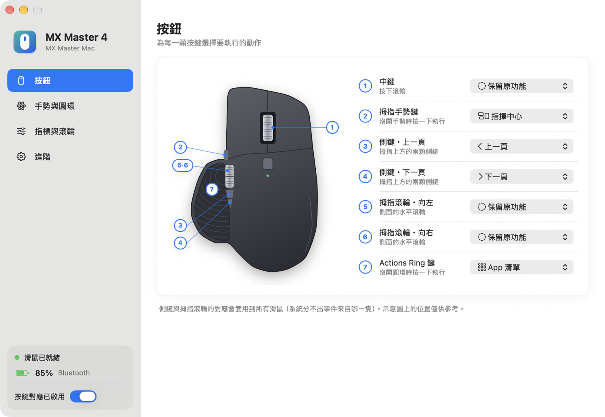
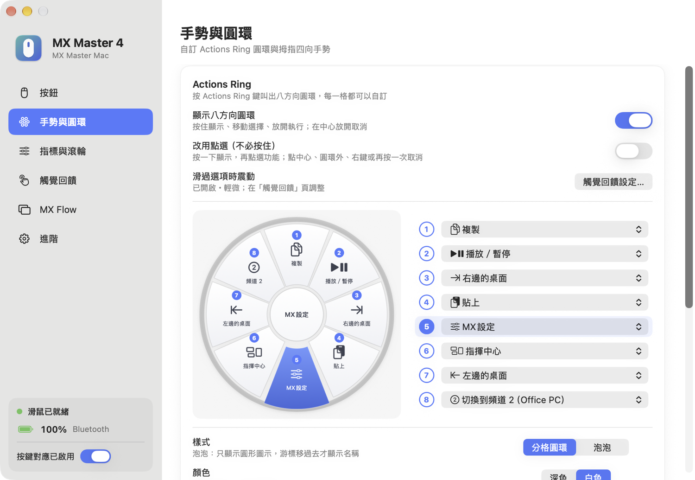
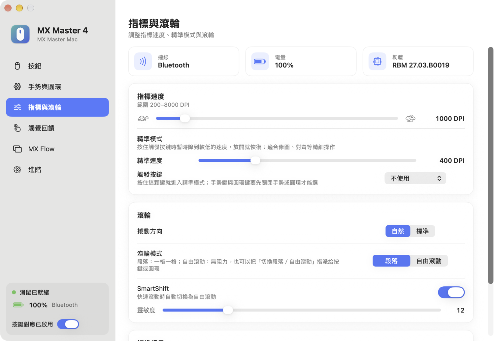
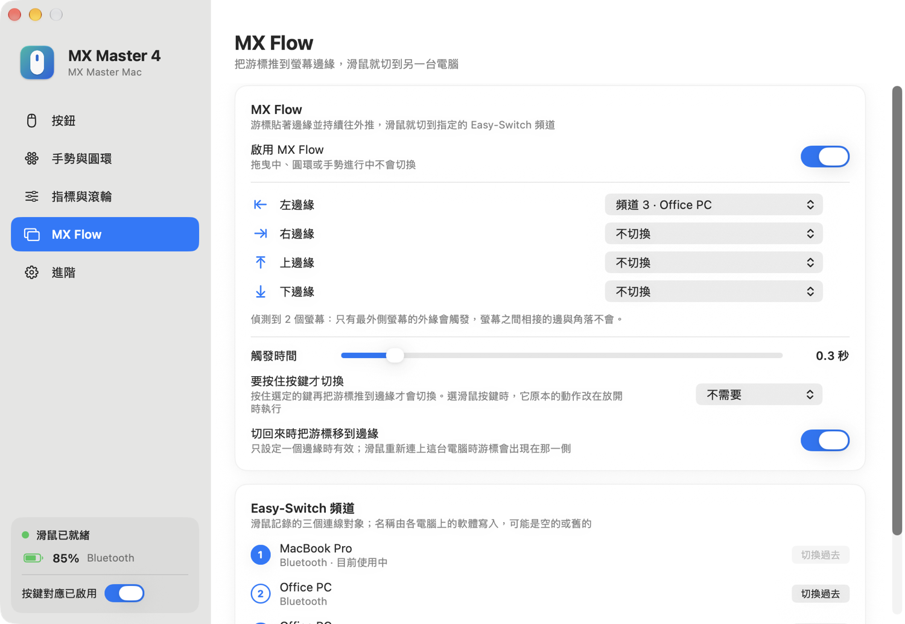

# MX Master Mac

<p align="center">
  <strong>繁體中文</strong> · <a href="README.en.md">English</a>
</p>

<p align="center">
  
</p>

MX Master Mac 是一款給 Logitech MX Master 4 用的 macOS 輕量小工具：常駐選單列，不裝 Logi Options+ 也能自訂按鍵、拇指手勢與 Actions Ring 圓環，並調整指標速度、SmartShift、捲動方向與觸覺回饋；2.0 起新增 **MX Flow**，把游標推到螢幕邊緣就能讓滑鼠切到另一台電腦。它是 Windows 版 [MX Master Portable](https://github.com/stone5202/MXMasterPortable) 的 macOS 版本，用 Swift 重新寫成。

> 目前版本：2.0 · 介面語言：繁體中文、English（預設跟隨系統）

各版本的更新內容請參閱 [更新紀錄](CHANGELOG.md) 或 [GitHub Releases](https://github.com/stone5202/MXMasterMac/releases)。

> 本專案為個人開源作品，與 Logitech 無任何關係，也未獲其認可或贊助。Logitech、MX Master、Logi Options+、Logi Bolt 為 Logitech 的商標。

## Screenshots

<p align="center">
  
</p>

<p align="center">
  
  &nbsp;
  
</p>

<p align="center">
  按鈕對應 · 手勢與圓環 · 指標與滾輪
</p>

<p align="center">
  
</p>

<p align="center">
  MX Flow
</p>

## 下載與使用

1. 到 [Releases](https://github.com/stone5202/MXMasterMac/releases/latest) 下載 `MXMasterMac.zip`，解壓縮後把 `MX Master Mac.app` 拖到「應用程式」。
2. App 沒有經過 Apple 公證。第一次開啟時 macOS 會擋下來：到「系統設定 → 隱私權與安全性」最下方按「仍要打開」。
3. 依畫面提示允許兩個權限（見下方「需要的權限」）。
4. 之後它會待在選單列（滑鼠圖示），點它可以開啟設定、暫停或結束。

請先結束 Logi Options+：兩者同時執行會互相覆寫按鍵與裝置設定。

## 功能

- **按鍵對應**：中鍵、拇指手勢鍵、兩個側鍵、拇指滾輪左右、Actions Ring 鍵，各自選擇動作。
- **內建動作**：約 50 種，包含上一頁／下一頁、指揮中心、App Exposé、顯示桌面、切換桌面、切換 App、複製／貼上／剪下、復原／重做、全選／儲存／尋找、播放／暫停、上一首／下一首、音量與靜音、分頁（新增／關閉／重開／重新整理／縮放）、視窗（最小化／關閉／全螢幕）、Spotlight、截圖、表情符號、鎖定螢幕、Finder、系統設定、計算機、活動監視器、輸入今天日期或目前時間、Enter、Esc、Delete。
- **自訂動作**：錄製任意組合鍵，或開啟 App、檔案、資料夾、網址。
- **Actions Ring 圓環**：八個位置都可自訂。可選按住模式（按住顯示、移動選擇、放開執行）或點選模式（按一下顯示，再點選）。外觀有「分格圓環」與「泡泡」兩種，大小與不透明度可調。
- **拇指四向手勢**：按住手勢鍵並滑動，四個方向的動作都可自訂。
- **裝置設定**：顯示電量與韌體版本；調整指標速度（DPI）、SmartShift、捲動方向與觸覺回饋強度。套用過的數值會保存，滑鼠重新連線後自動再套用。
- **MX Flow**：游標持續推著螢幕邊緣，滑鼠就切到指定的 Easy-Switch 頻道（另一台電腦）。四個邊緣可分別指定頻道，觸發時間可調，可要求按住一個鍵盤按鍵或滑鼠按鍵才切換；多螢幕時只有最外側螢幕的外緣會觸發。也會列出三個頻道記錄的電腦名稱，並可直接按鈕切換；選單列的選單裡也有 MX Flow 開關。
- **切換連線後自動恢復**：滑鼠切到別台電腦再切回來，或在 Bluetooth 與 Logi Bolt 之間切換，專用按鍵會自動重新啟用。
- **其他**：設定自動儲存、只會執行一份、可暫停、可設定登入時自動啟動、介面可切換中文／英文。
- **工程模式**：檢視滑鼠送出的事件，方便回報問題。

## 系統需求

- macOS 14 或更新版本，Apple 晶片（開發與測試環境為 macOS 27）
- Logitech MX Master 4（Bluetooth 或 Logi Bolt 接收器）

## 需要的權限

- **輸入監控**：經 macOS 內建的 HID 介面與滑鼠通訊（專用按鍵、電量、裝置設定）。
- **輔助使用**：送出快捷鍵，以及攔截側鍵與拇指滾輪。

## 已知限制

- 只在 MX Master 4（韌體 `RBM 27.03`）上開發與測試；其他型號沒有測過。
- 發布檔沒有 Apple 公證，也沒有開發者簽章；更新版本後可能需要重新允許兩個權限。
- 與 Logi Options+ 同時執行時，兩者會互相覆寫按鍵改道與裝置設定，請擇一使用。
- 側鍵與拇指滾輪的對應會套用到所有滑鼠（系統事件分不出來源裝置）。
- 指揮中心、App Exposé、顯示桌面、切換桌面等動作是送出系統預設的快捷鍵；在「系統設定 → 鍵盤 → 鍵盤快速鍵」改過或關掉的話不會有作用。
- MX Flow 只切換滑鼠：不傳送剪貼簿或檔案，鍵盤不會跟著切換。另一台電腦也要執行有 MX Flow 的版本並設定邊緣，才能用同樣方式切回來；否則請按滑鼠底部的 Easy‑Switch 鍵。
- 滑鼠重新連上這台電腦時分不出是從哪裡切回來的；設定了多個邊緣時，游標不會自動移到邊緣。
- 不包含 Options+ 的逐應用程式設定與韌體更新。
- 示意圖上的按鍵位置為示意，尚未逐一對照實體校正。

## 運作方式

- 專用按鍵（拇指手勢鍵 `0x00C3`、Actions Ring 鍵 `0x01A0`）：透過 `IOHIDManager`，以 HID++ 2.0 的 `0x1B04` 功能設定「暫時改道」，再接收按鍵通知。程式暫停或結束時會解除改道。
- 一般按鍵與水平滾輪：`CGEventTap` 攔截，再以 `CGEvent` 送出鍵盤動作。
- 裝置設定：HID++ 功能 `0x1004`（電量）、`0x0003`（韌體）、`0x2201`（DPI）、`0x2111`（SmartShift）、`0x2121`（捲動方向）、`0x19B0`（觸覺回饋）。每次寫入後都會回讀確認。
- MX Flow：`NSEvent` 監看游標移動，判斷是否貼著最外側螢幕的外緣並持續往外推；以 HID++ 功能 `0x1814`（切換主機）送出切換，`0x1815` 讀取各頻道的主機名稱。
- 重新連線偵測：`0x1D4B` 的通知、裝置出現／消失、系統喚醒；沒連上時每 3 秒重試。

HID++ 的功能編號與封包格式參考了開源專案 [Solaar](https://github.com/pwr-Solaar/Solaar) 與 [logiops](https://github.com/PixlOne/logiops) 的公開實作。

## 隱私

- 程式不會建立任何網路連線，也不包含分析、廣告或追蹤元件。
- 設定儲存在 `~/Library/Application Support/MXMasterMac/config.json`。
- 只有在工程模式開啟「寫入記錄檔」時，才會把滑鼠事件寫入同一個資料夾的 `events.log`；記錄內容是按鍵與 HID 封包，不含鍵盤輸入。
- 不安裝驅動或系統延伸功能。

## 從原始碼建置

需要 Xcode（只用它的 `swiftc`），沒有外部相依套件：

```bash
git clone https://github.com/stone5202/MXMasterMac.git
cd MXMasterMac
./build.sh
open "build/MX Master Mac.app"
```

`build.sh` 會用鑰匙圈裡的 Apple Development 憑證簽章（重新建置後權限才不會失效），沒有憑證時改用臨時簽章。`./build.sh --release` 產生臨時簽章的發布檔 `build/MXMasterMac.zip`。

啟動參數：`--show` 啟動後開啟設定視窗、`--log` 啟動後就寫入工程記錄。

## 專案結構

```text
Sources/
├── main.swift          # 選單列 App 與設定視窗
├── AppModel.swift      # 執行期狀態與輸入處理
├── HIDPP.swift         # IOHIDManager 與 HID++ 2.0
├── EventTap.swift      # 一般按鍵與水平滾輪的攔截
├── EdgeSwitch.swift    # MX Flow：螢幕邊緣判定與設定
├── Actions.swift       # 動作清單與執行
├── RingOverlay.swift   # 圓環與手勢提示
├── SettingsView.swift  # 設定介面（SwiftUI）
├── MouseDiagram.swift  # 滑鼠示意圖
└── Config.swift        # 設定檔與語言
Resources/app.png       # App 圖示來源
docs/screenshots/       # README 用的畫面截圖
build.sh                # 建置腳本
```

## 參與開發

歡迎提交 issue 或 pull request。回報按鍵或裝置相關問題時，請附上工程模式的記錄，以及連線方式、macOS 版本與滑鼠韌體版本。

## License

本專案採用 [MIT License](LICENSE)。
